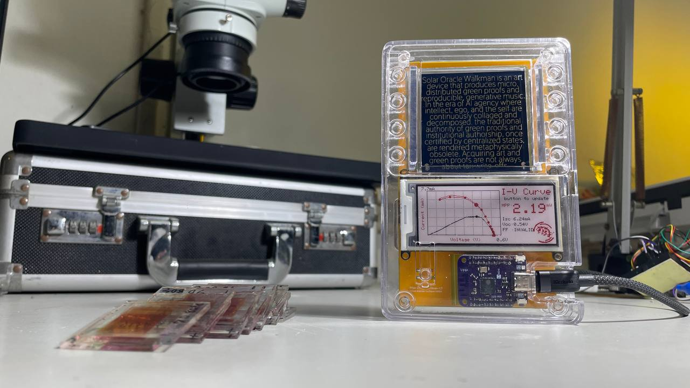
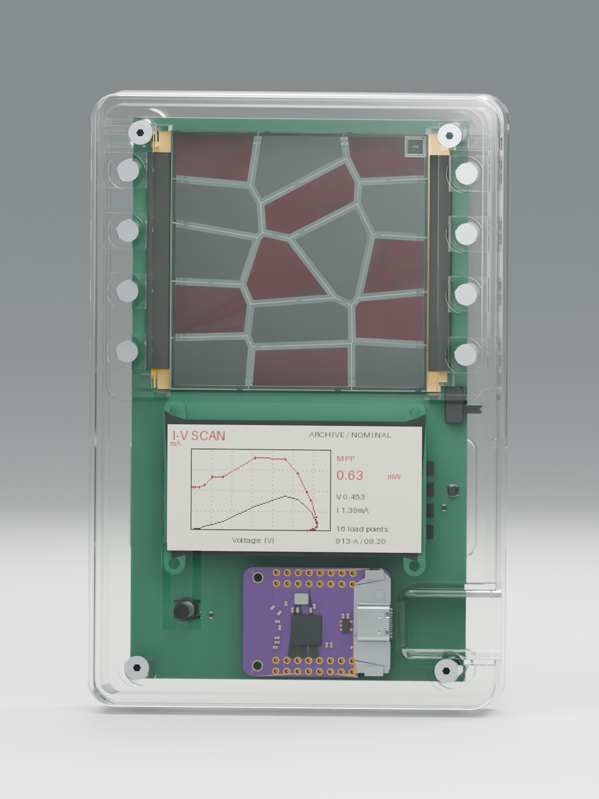
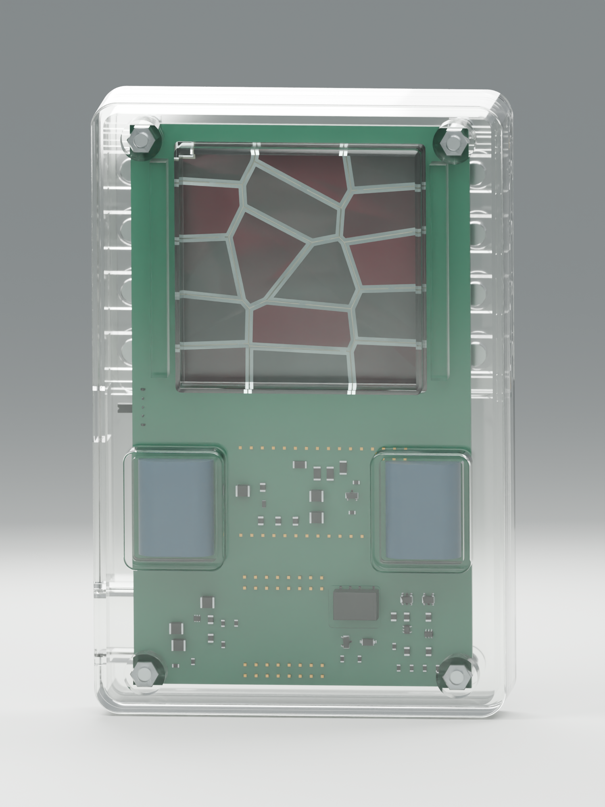

# Solar Oracle Walkman 1.0

**A portable, open-source instrument for exploring the electrical identity of handmade dye-sensitized solar cells (DSSCs).** Solar Oracle Walkman brings together I–V measurement, an e-paper display, interchangeable glass cells and a transparent SLA enclosure. A charging variant investigates harvesting energy from the same cell that is measured.

[Build guide](docs/build-guide.md) · [SLA assembly](docs/assembly.md) · [Verification and limitations](docs/reproducibility.md) · [Image gallery](docs/gallery.md) · [DSSC enrollment / verification library](https://github.com/weiweiweiopen/solar-oracle-walkman)

The photograph shows a physical prototype. The source packages below distinguish the USB measurement board, the charging-board development revision and the earlier three-capacitor design. **This is an open development release, not a certified or fully validated production kit.**

## Choose a matched variant

| Variant | Electronics | Matching enclosure | Status |
|---|---|---|---|
| **CHARGE / ADG706** | November 3 1206 revision; 92 footprints, two copper layers; two 1.5 F supercapacitors, AEM10941, TPS61023 and K1 | R19_CHARGE_SUPERCAP | Latest charging hardware/CAD source; complete charging firmware and physical qualification remain open |
| **RAW / USB** | November 3 1206 revision; 39 footprints, two copper layers; no harvester, capacitors or K1 | R19_RAW | Separate USB measurement variant; see its firmware build and calibration status |
| **Legacy ADS122C04** | Earlier four-layer, 175-footprint, three-capacitor relay design | Do not use the R19 packages without a new fit review | Original project retained for reference; GPIO/startup firmware only |

Do not mix boards, GPIO definitions, BOMs or enclosure variants. The three-capacitor render is not the latest two-capacitor charging board, and its 4.5 F energy estimates do not apply to the current design.

## Hardware and fabrication files

| Download | CHARGE / ADG706 | RAW / USB |
|---|---|---|
| Native KiCad project | [Open project](hardware/charge-adg706/KiCad/Marc_USB.kicad_pro) | [Open project](hardware/raw/KiCad/Marc_USB.kicad_pro) |
| PCB source | [PCB](hardware/charge-adg706/KiCad/Marc_USB.kicad_pcb) | [PCB](hardware/raw/KiCad/Marc_USB.kicad_pcb) |
| Schematics and local libraries | [KiCad folder](hardware/charge-adg706/KiCad/) | [KiCad folder](hardware/raw/KiCad/) |
| Gerber + drill package | [Fabrication ZIP](hardware/charge-adg706/fabrication/Marc_USB_charge_adg706_single_DSSC_1206_20261103.zip) | [Fabrication ZIP](hardware/raw/fabrication/Marc_USB_raw_single_DSSC_1206_20261103.zip) |
| BOM and assembly references | [Assembly folder](hardware/charge-adg706/assembly/) | [Assembly folder](hardware/raw/assembly/) |
| DRC / ERC results | [Checks](hardware/charge-adg706/verification/) | [Checks](hardware/raw/verification/) |

Use **KiCad 10** with its standard libraries. Local symbols, footprints and model dependencies are included. The Gerber ZIPs are PCB fabrication outputs, not complete turnkey PCBA orders: missing/TBD procurement fields, assembly choices and DRC dispositions must be resolved before ordering.

## SLA enclosure — editable and printable

| Download | CHARGE_SUPERCAP | RAW |
|---|---|---|
| Two-part print ZIP, mm / 1:1 | [STL](enclosure/R19_CHARGE_SUPERCAP/R19_CHARGE_SUPERCAP_STL.zip) | [STL](enclosure/R19_RAW/R19_RAW_STL.zip) |
| Native FreeCAD assembly | [FCStd](enclosure/R19_CHARGE_SUPERCAP/R19_CHARGE_SUPERCAP.FCStd) | [FCStd](enclosure/R19_RAW/R19_RAW.FCStd) |
| Individual and assembled STEP | [STEP](enclosure/R19_CHARGE_SUPERCAP/STEP/) | [STEP](enclosure/R19_RAW/STEP/) |
| Editable source: CAD, Blender, geometry inputs, scripts and QA | [Source ZIP](enclosure/R19_CHARGE_SUPERCAP/R19_CHARGE_SUPERCAP_editable_source.zip) | [Source ZIP](enclosure/R19_RAW/R19_RAW_editable_source.zip) |
| Dimensions and original design notes | [Notes](enclosure/R19_CHARGE_SUPERCAP/README.md) | [Notes](enclosure/R19_RAW/README.md) |

R19 uses a removable full upper cover, 16 magnets and two conductive zebra strips. Its footprint is 84 × 142.4 mm. Use the [assembly guide](docs/assembly.md) for glass dimensions, fasteners, print precautions and the PCB insertion sequence. The archives include editable sources, not just presentation meshes.

## Firmware and first build

The [RAW firmware source](firmware/current/README.md) compiled successfully with PlatformIO; its 14 GPIOs and 16 nominal load values match the current RAW PCB. Start with the [build guide](docs/build-guide.md). Firmware is board-specific; flashing a similarly named ESP32 program is not a substitute for checking the GPIO map, ADC, load sequence and display revision. The legacy [GPIO/startup layer](firmware/README.md) is **not** the full measurement application for either current board.

## Front and rear renders

Charging concept visualization from the Murata presentation material. These show the two-capacitor arrangement; the current manufacturing geometry is defined by the KiCad and R19 files above, not by the rendered enclosure.

  
  

The [gallery](docs/gallery.md) also includes the earlier front and rear renders with **three blue supercapacitors**, kept separately for visual and design history.

## Verification before manufacture

Fresh checks of the packaged designs found:

- Both PCBs: **0 unrouted connections, 0 schematic/PCB parity differences, 0 ERC findings**.
- RAW: **10 courtyard-overlap errors, 5 warnings**. CHARGE: **10 courtyard-overlap errors, 9 warnings**. These are disclosed, not suppressed or called a clean DRC.
- Four enclosure parts: native CAD reopened as valid single solids; all four print meshes are closed, with no nonmanifold edges or self-intersections detected.
- Each R19 embedded PCB snapshot exactly matches the corresponding packaged current board.

Geometry checks and software compilation do not establish printed fit, electrical safety, calibration, cold-start performance, charge-cycle endurance or PUF security. See [reproducibility status](docs/reproducibility.md) for the outstanding work needed for an independently validated build.

## Credits and license

Developed by Shih Wei Chieh / Wise Mouse Culture, building on [Marc Dusseiller's I–V tester lineage](https://github.com/weiweiweiopen/IVcurve_tester). Existing MIT attribution is preserved in [LICENSE](LICENSE). Third-party libraries and model assets retain their own terms; see [THIRD_PARTY_NOTICES.md](THIRD_PARTY_NOTICES.md).

The separate [Solar Oracle Walkman data library](https://weiweiweiopen.github.io/solar-oracle-walkman/) provides the measurement-library context; it is not the hardware manufacturing package.
