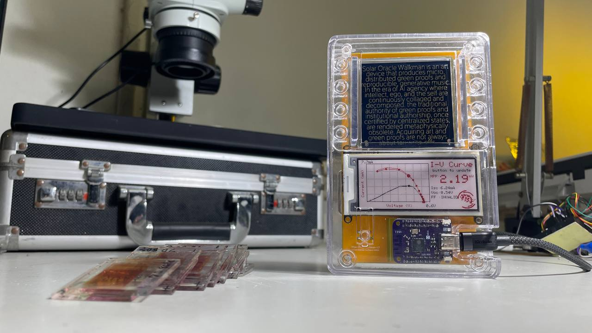
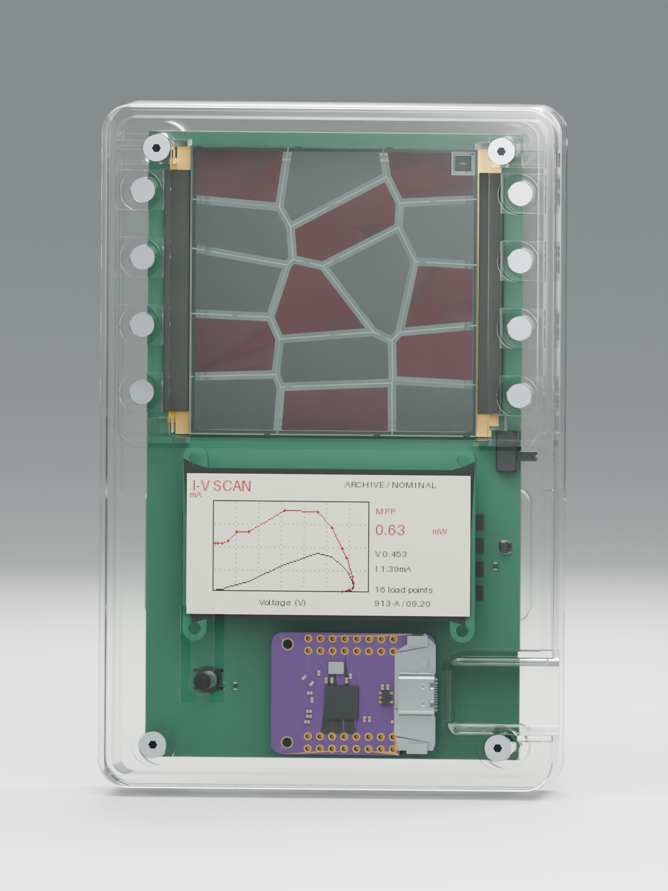
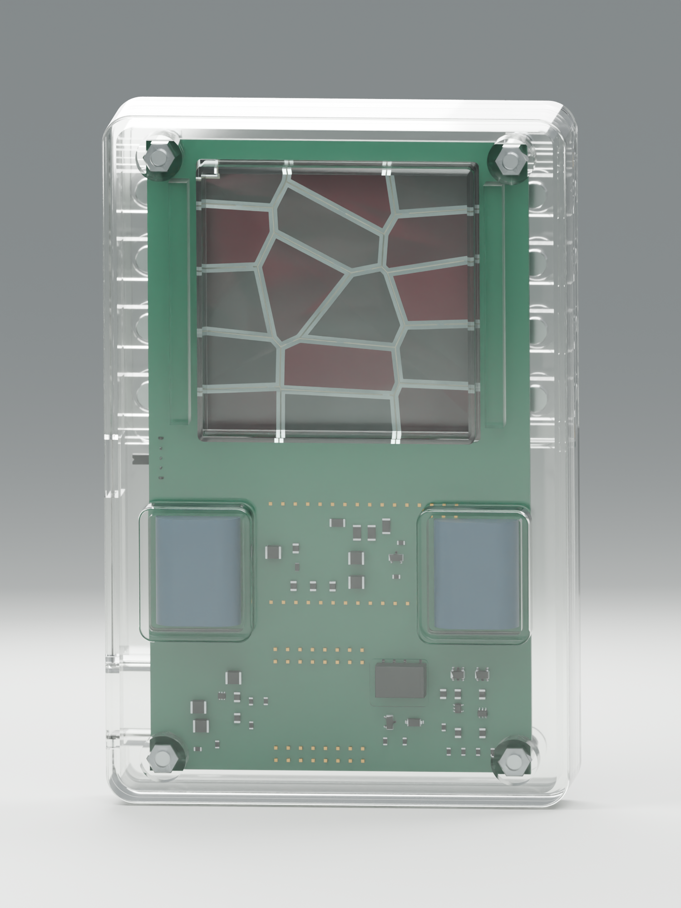
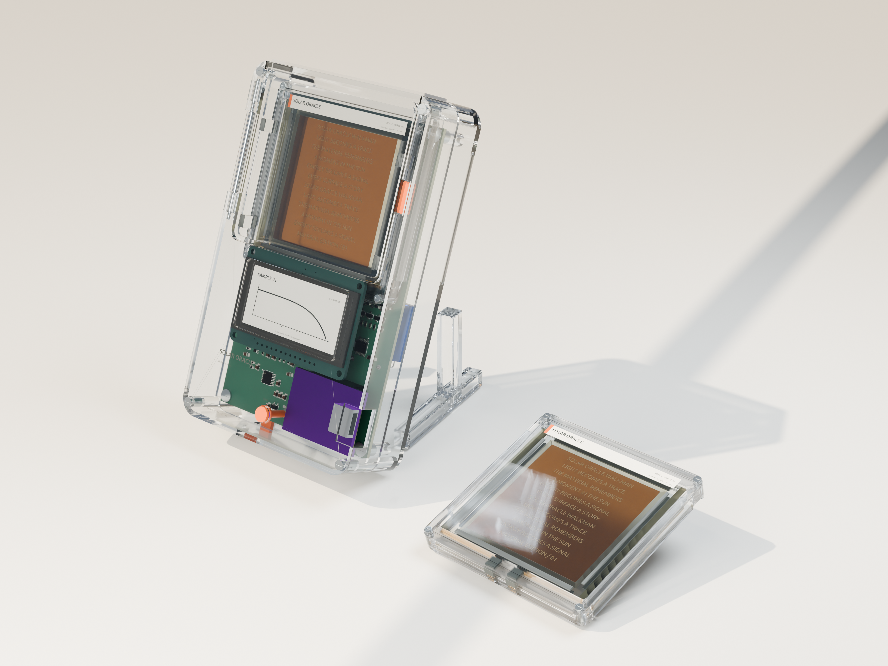
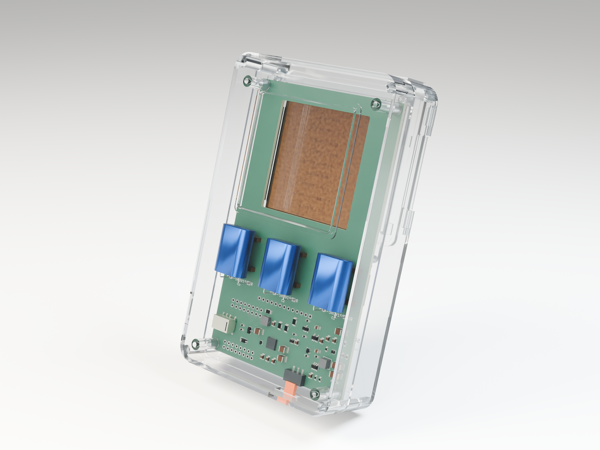

# Solar Oracle Walkman — prototype and renders

## Physical prototype

Photograph supplied by Shih Wei Chieh on November 10, 2026. A USB cable is connected. The photograph alone does not establish autonomous operation, calibration or which electrical revision is fitted.

## Two-capacitor charging concept — October 30, 2026

From the Murata glass/RFID presentation assets. The source manufacturing revision is the November 3 charge-adg706 PCB paired with the November 5 R19_CHARGE_SUPERCAP enclosure. These illustrations predate that enclosure and are not assembly drawings.

## Earlier three-capacitor concept — September 30, 2026

From the Murata presentation assets. This is the earlier three-capacitor design, not the current two-capacitor charge-adg706 revision. Do not infer component placement or energy capacity for a current build from this image.

Original image filenames and SHA-256 checksums: [provenance](images/provenance.json).
